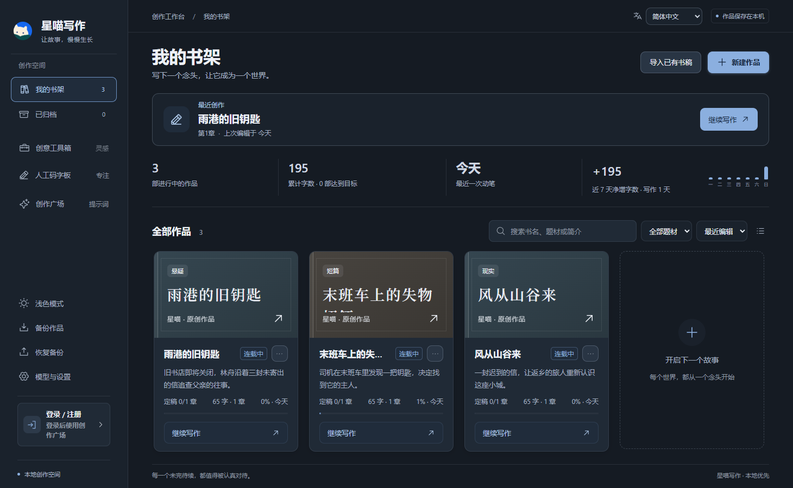

[English](README.md) | **简体中文**

  

<h1 align="center">星喵写作</h1>

<strong>本地优先的小说工作台：人工码字、AI创作、故事规划与资料联动，让故事慢慢生长。</strong>

  
  
  

  <a href="https://github.com/z55902383-debug/xingmiao-writer-releases/releases/download/v1.0.0/XingmiaoWriter-1.0.0-x64-Setup.exe">下载 Windows 安装包</a> ·
  <a href="https://github.com/z55902383-debug/xingmiao-writer-releases/releases/tag/v1.0.0">更新与附件</a> ·
  <a href="https://github.com/z55902383-debug/xingmiao-writer-core">开源版源码</a>

**会员免费，无需付费开通。** 完整版的会员区分用于管理广场提示词库与相关权限，不是收费套餐。第三方模型和生图费用由服务商决定，开源版不含账号与广场。

## v1.0.0 本次更新

- **故事资料更完整**：知识蓝图、地点地图、人物/物品引用和父子地图导航；独立金手指档案支持多人能力与启用范围。
- **创作与资料联动**：分类备忘录、人工灵感引用及跨页导航；章节定稿前核对资料同步，保留证据与重复写入保护。
- **日常操作更稳妥**：保存失败保留正文并阻止离开；新书构思在会话内保留；优化弹窗焦点、页签键盘、低窗口布局、主题对比度与启动体验。
- **版本统一**：现有项目、软件信息、安装包和发布记录统一为1.0.0。

完整版工具箱支持生成内容分析、目标预览、核对后加入作品，以及按已确认资料继续新书准备。**自动创作目前为配置及运行页预览**：可保存配置并创建真实作品，但运行页仍为计时演示，尚未实现无人值守全书生成、后台调度和崩溃续跑。

[1.0.0使用指南](docs/1.0使用指南.md)

## 主要功能

知识蓝图和地图、金手指档案、分类备忘录与章节资料同步，可与现有写作流程配合使用。

- 短篇由想法、简纲直接拆章；长篇按总纲、分卷、卷纲/细纲、章规划、正文逐步生成与采用，名称与内容同步到对应位置。
- 人工码字板：独立草稿、专注计时、目标统计、查找替换、稿件历史与存入作品。
- 写作助手：写作、续写、润色与检查，实际生成状态、停止入口、候选预览和防覆盖检查。正文变化分析可选，采用后仍可重新分析。
- 资料整理助手：查询与调整人物、世界、关系、时间线、伏笔和规划资料；逐项核对采纳、重新核对、撤销与删除恢复。该助手不读取或修改章节正文、章纲、风格档案和备忘录。
- 风格、要求与Skill：多条资料编辑、导入蒸馏、选择与删除；每次生成单独选择并核对实际引用。14项可编辑内置写法，默认不强制启用。
- 本地书架、归档、分卷章节、人物世界、图谱、时间线、资料画布、备忘录、历史和回收站；中英界面及深浅主题。
- 章节定稿后由作者确认完结，改稿取消完结；TXT/Markdown导出、JSON备份与副本恢复。

线上广场已支持专项工具标签与完整提示词正文；刷新或重新添加时同步标签，同时保留本地编辑、开关和自定义范围。

## 完整版附加功能

创意工具箱、封面生图、账号、会员、共享广场及安装更新。离线编辑无需登录。账号和广场依赖维护者后端；用户名密码入口需要服务端部署相应账号接口。手机号是联系信息，不用于自动证明账号归属。AI与生图需要自己的服务配置。

## 安装与更新

下载Setup.exe按向导安装，可选择D盘等目录。更新先保存编辑内容并备份，再打开安装向导，默认带入当前程序目录；安装前请确认位置。安装位置变化不会自动迁移书库。

## 数据与使用边界

作品保存在本机，书库位置可在设置中更换。安装目录与书库独立，更新或迁移前请备份。

JSON备份包括最终作品资料、章节及历史、Skill和回收站；**不包含模型密钥、账号会话、资料整理对话、方案撤销历史及资料重建/拆文分析过程**。恢复创建副本，旧对话不能用于撤销，但回收资料仍可恢复。

AI请求把本次选中的正文和资料发送到配置的模型服务，输出需作者审核。本地模拟检查不代表真实模型质量或网络可用性。Windows x64安装包未配置代码签名证书。

## 说明与反馈

[功能说明](docs/features.md) · [资料整理](docs/资料整理使用说明.md) · [创作流程](docs/分步创作流程与采用说明.md) · [人工码字](docs/人工码字板使用说明.md) · [风格参考](docs/风格选择与参考资料说明.md) · [本次检查](docs/检查记录-v1.0.0.md)

完整版附加模块未开源，核心MIT许可不覆盖附加模块。反馈通过Issues提供版本和复现步骤，不附账号会话、密钥或私人小说。
